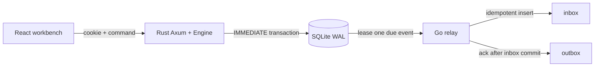

# SlotForge architecture

The diagram is deliberately local: one Rust process owns all reservation state transitions. The Go relay never calculates availability, changes a reservation, or recreates a second state machine.

## Command boundary

For a reservation, cancellation, check-in, event creation, or event patch, Rust takes the local command lock, checks `(actor_id, Idempotency-Key)`, clones the current `Engine`, runs the domain command, then opens an SQLite `IMMEDIATE` transaction. That transaction writes:

1. complete `PersistedEngineState`;
2. outer idempotency receipt and server-assigned timestamp;
3. every outbox row inferred from new reservation/event audit entries.

Only after commit does the process replace its in-memory engine. A failed SQL transaction therefore cannot appear as a successful in-memory reservation. The inner Engine request id is a SHA-256 of actor and outer key, preventing two actors with the same client-provided key from sharing an idempotency record.

`Event.revision` starts at 1. `PATCH /events/{id}` requires `If-Match`; title, capacity, times, booking close, and active state pass through one `update_event` command. Capacity changes promote FIFO waiters before close in that same command. A stale editor gets structured 409 `REVISION_CONFLICT`.

## Outbox and inbox

`outbox` has an immutable event id derived from the committed audit sequence, aggregate reference/version, type, recipient, canonical JSON payload, SHA-256, attempt and lease fields. Event types include `reservation.confirmed`, `reservation.waitlisted`, `reservation.cancelled`, `reservation.promoted`, `reservation.checked_in`, and `event.updated`.

Go claims one due row with `BEGIN IMMEDIATE`, sets a 60-second lease, and increments attempts. It recalculates the payload hash, then writes the recipient inbox in a transaction. The inbox has `event_id UNIQUE`; a repeat with the same hash is a no-op, while a different hash is rejected and sent to `dead_letter`. Only after the inbox transaction commits does Go ack the outbox row. Thus a process failure between those operations creates at-least-once delivery but one visible inbox item.

Retries are 2/4/8/16/32/60 seconds, capped at eight attempts. `dead_letter` is a real diagnostic state; a coordinator may requeue it, while participants cannot view or change delivery rows.

## Data and UI boundary

The React UI reads only API-derived events, reservations, notifications and delivery records. It does not derive availability, capacity, waitlist order, revision, or delivery state locally. The build is served from `web/dist` by the Rust `serve` command; Vite's proxy is development-only.
